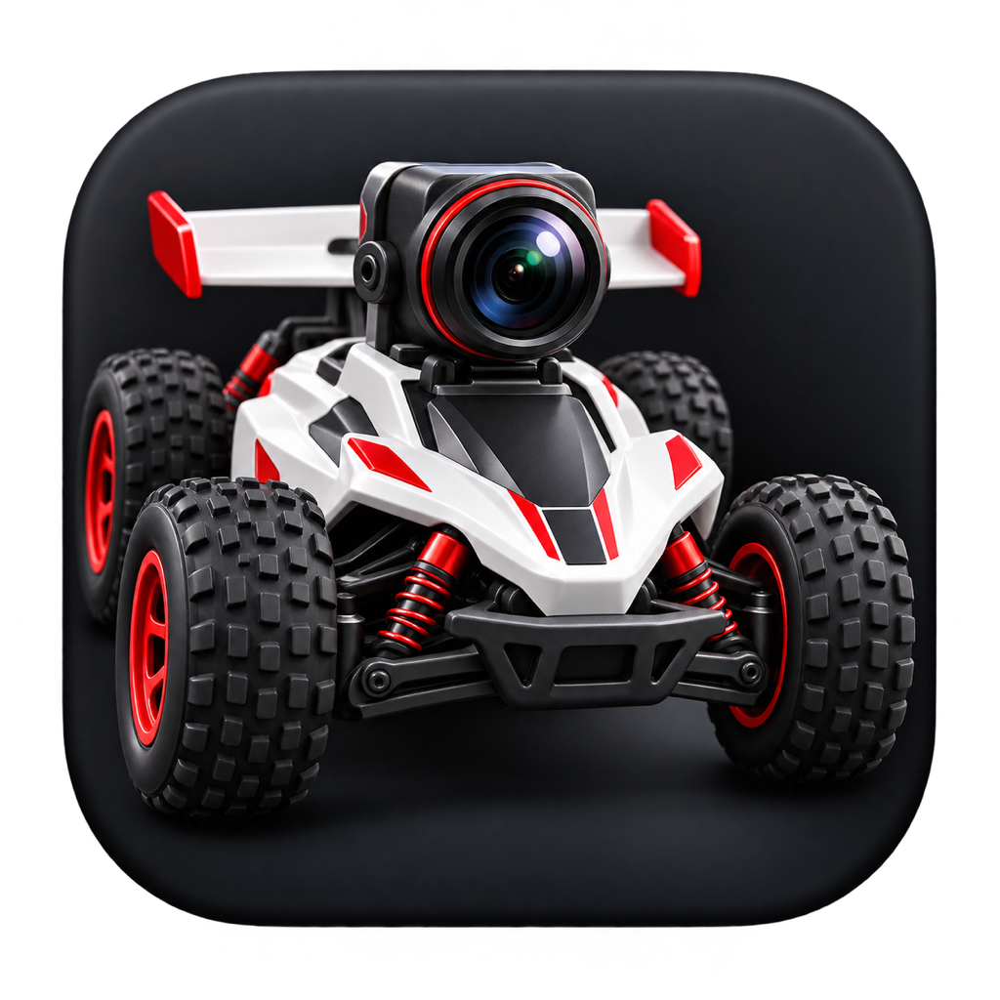
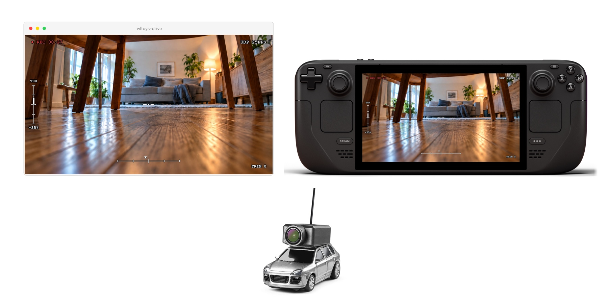
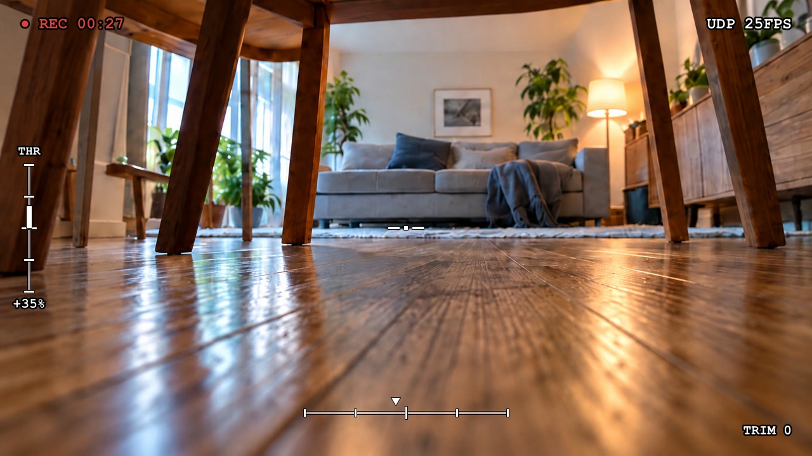

# wltoys-drive





*Product photos with the app's HUD over an illustrative FPV scene.
[Image sources](assets/readme/sources.json).*

Native driver for the WLtoys 6401 1/64 WiFi FPV car. Live camera video with an
FPV-style HUD, keyboard or gamepad driving, and direct Wi-Fi connection to your
own car. Runs locally and works without internet after downloading.

Tested only on the WLtoys 6401. Other models and firmware revisions are unsupported.

## Download and launch

Get the matching **platform asset** from the
[latest release](https://github.com/jeremymouton/wltoys-drive/releases/latest),
then extract the entire archive. The platform downloads contain Node, mpv and
native helpers; there is no runtime installation step.

| Platform | Download | Launch |
|---|---|---|
| macOS, Apple Silicon | `wltoys-drive-macos-arm64.zip` | Open **WLtoys Drive.app**; optionally move it to Applications |
| Steam Deck / Linux x64 | `wltoys-drive-linux-x64.tar.gz` | Open **wltoys-drive** from the extracted folder |
| Linux ARM64 | `wltoys-drive-linux-arm64.tar.gz` | Open **wltoys-drive** from the extracted folder |
| Windows 10/11 x64 | `wltoys-drive-windows-x64.zip` | Open **WLtoys Drive.exe** from the extracted folder |
| Windows 11 ARM64 | `wltoys-drive-windows-arm64.zip` | Open **WLtoys Drive.exe** from the extracted folder |

Choose the download matching your operating system's architecture. Steam Deck
uses **x64**. Windows shows the system type in **Settings → System → About**;
on Linux, `uname -m` reports `x86_64` for x64 or `aarch64` for ARM64.

macOS release builds use macOS 14 runners; the bundle's Info.plist records the
actual minimum OS required by its binaries. Locally built bundles can require a
newer macOS. Linux builds target Ubuntu 22.04's glibc baseline (2.35), including
SteamOS; systems with older glibc or without NetworkManager are not supported
for automatic Wi-Fi connection. Windows gamepads must support **XInput** (Xbox
controllers and compatible devices); keyboard driving needs no controller.
Intel Macs are not release targets. ARM64 packages are built and exercised on
native Linux and Windows ARM64 runners, including startup, video, input and
failsafes. Physical ARM64 Wi-Fi adapters and gamepads still need hardware testing.

The Mac app is ad-hoc signed, **not Apple-notarized**. Windows builds are
unsigned. OS download protections can therefore require your normal approval
before opening them. Published assets include `SHA256SUMS`, dependency notices
and a `build.json` recording dependency versions and sources.

Development branch packages are also available as artifacts of the
[Standalone apps workflow](https://github.com/jeremymouton/wltoys-drive/actions/workflows/release.yml).

## Connect and drive

1. Turn the car on with its physical remote **off**, then wait for the camera's
   green light.
2. Launch the app. Its window opens immediately and scans for nearby cars.
   One car connects automatically. If several are in range, choose one in the
   app with a click, Up/Down and Enter, or your gamepad's D-pad and A button.
   If no car is found yet, the app keeps searching; turn the car on and wait.
3. Click the video window, then drive with WASD/arrows or your gamepad. Close
   the video window to stop and exit. **Space** sends neutral, including when
   a controller's throttle is held.

macOS requires **Location access to scan nearby Wi-Fi networks**. The permission
request explains that it is used to find your car; the app does not request
coordinates. Recent Windows versions may also require Location access for
Wi-Fi discovery. If access is denied, the app explains it and offers an
**Open settings** button, then continues discovery when access is available.

Joining the car's Wi-Fi normally disconnects that device from the internet.
The app already contains everything it needs to drive offline.

Mac keyboard input stays inside the focused video window. **Input Monitoring
and Accessibility permission are not required.** Leaving the window clears held
keys immediately. Windows also ignores driving keys when its video window is
unfocused. Controller input remains live.

macOS and Windows open windowed by default. Linux/Deck uses fullscreen;
`FULLSCREEN=1` or `FULLSCREEN=0` overrides the default.

## Steam Deck

Extract the Linux download in Desktop Mode, right-click **wltoys-drive** in
Dolphin and choose **Add to Steam**. Return to Game Mode and launch that shortcut.
If your file manager asks about execution permission, mark the launcher executable.
Keep the app on an executable filesystem, not a `noexec` SD-card mount.
The package does not modify SteamOS or install system packages.

For a Linux applications-menu entry, run **Install desktop shortcut.sh** once
from the extracted folder. It creates only a user desktop entry; moving the app
folder requires running it again. Game Mode car selection uses the gamepad and
on-screen picker. `JS_DEVICE` can select another Linux joystick device.

## Updates and logs

To update a standalone app, close it and extract the new platform download.
Keep the whole package together; don't replace only the launcher executable.
Saved trim (`~/.wltoys-trim`), the last car (`~/.wltoys-car`) and recordings
(`~/Videos`) live in your user folder. HUD and keyboard transport files use a
private temporary directory per session. GUI-launch logs are written to
`~/wltoys-drive.log` (your user profile folder on Windows).

## Run or build from source

Source launchers remain available on Linux/Deck and Apple-Silicon macOS:

```bash
bash install.sh  # downloads portable Node; installs mpv via Flatpak or Homebrew
bash run.sh
```

macOS source setup needs Homebrew. Building the Mac helpers also needs Xcode
Command Line Tools (`bash gamepad/build-mac.sh`). Windows source runs need Node,
mpv on PATH, and a built helper (`powershell -File gamepad/build-windows.ps1`,
with MinGW GCC available), then `node drive.mjs`. On Windows ARM64, use the
MSYS2 CLANGARM64 toolchain and add `-Compiler clang` to the helper build command.

Build a platform package **on the matching operating system and architecture**:

```bash
node packaging/build.mjs
node packaging/verify.mjs dist/wltoys-drive-macos-arm64.zip  # select your archive
```

Build prerequisites: macOS has Xcode Command Line Tools, Homebrew and mpv;
Linux has GCC, mpv and Debian package metadata; Windows has MinGW GCC, 7-Zip, CMake and Visual Studio 2022 C++ build tools.
Packaging downloads and verifies a pinned Node runtime and Windows player;
Mac/Linux player dependencies come from the build machine and are recorded in
the manifest. See `.github/workflows/release.yml` for the release build environment.
Tagged builds publish all three packages only after their native checks pass.

`bash update.sh` updates source installations only. It deliberately refuses
portable app folders. `node drive.mjs --selftest` checks protocol/input logic;
`--hud-demo` previews video and HUD without a car, and `--list` reports gamepad
mapping. `CAR_SSID="WL FPV CAR 75899112"` pins the car; `NO_AUTOCONNECT=1` uses
whatever network is already joined. All existing configuration below still applies.

## Controls



*The app's HUD, rendered over an illustrative FPV scene.*

| Input | Action |
|---|---|
| Left stick | Steer |
| Right trigger / A | Forward |
| Left trigger / B | Reverse |
| W / ↑ | Forward (keyboard) |
| S / ↓ | Reverse (keyboard) |
| A / ← · D / → | Steer (keyboard) |
| Space | Stop (keyboard) |
| D-pad left/right | Steering trim (persists) |
| D-pad up · H | Toggle HUD overlay |
| Y · R | Toggle recording (R = keyboard) |
| Exit game / close window / Ctrl-C | Stop |

Keyboard steering requires no controller and works while the mpv window has focus.
Releasing all keys returns to neutral; a failsafe forces neutral if the input
stalls. Gamepad and keyboard can be used together. The Mac download includes a
native video window that handles simultaneous keys locally. Source users should
build that player with `bash gamepad/build-mac.sh`; regular mpv alone retains
the one-held-key fallback.

Run `./run.sh --list` to print live axis and button numbers for mapping a controller.

## Auto-connect and reconnect

The driver joins the car's WiFi on launch and rejoins it if the link drops.

- **Steam Deck / Linux** scans for `WL FPV CAR …` networks and connects. One match
  joins directly; multiple show a picker (on screen in Game Mode);
  an existing car connection is reused.
- **Windows** uses the native WLAN API for a fresh scan and automatic joining.
  If Windows requires Location access, the app explains that it is needed to scan
  Wi-Fi networks and offers a button to open the permission settings.
- **macOS** scans nearby Wi-Fi networks through its native app window. Allow
  Location access when prompted so it can find cars, including never-paired cars.
  The app requests network names, not coordinates.
- All three platforms join one discovered car automatically and show an in-app
  picker for several cars. With none nearby, the window stays open and retries.
- On a drop, the OSD shows `RECONNECTING…`, the car is held at neutral, and the
  driver rejoins with backoff. A brief video stall does not trigger a rejoin. After
  repeated failures it stops and holds neutral.
- Set `NO_AUTOCONNECT=1` to disable auto-join and reconnect and use the current
  network.

## Recording

Press **Y** on the controller or **R** on the keyboard to toggle recording. Clips are
saved to `~/Videos/wltoys-<timestamp>.h265` (raw HEVC; remux with
`ffmpeg -i clip.h265 -c copy clip.mp4`). UDP video mode only.

Recording starts at the next keyframe so the clip is playable from the first frame.
If you hit record before the video feed is up, nothing is captured — the empty file
is removed and the reason is printed rather than leaving a 0-byte clip behind.

## Configuration

Set via Steam Launch Options (`VAR=value %command%`) or inline (`VAR=value ./run.sh`).

| Variable | Default | Description |
|---|---|---|
| `CAR_IP` | `172.16.11.1` | Car address; also the expected gateway for auto-connect |
| `CAR_SSID` | auto | Car WiFi name to join directly; optional override for nearby-car discovery |
| `NO_AUTOCONNECT` | off | `1` disables auto-join and reconnect |
| `VIDEO_MODE` | `udp` | `udp` (low-latency) or `rtsp` (fallback) |
| `FULLSCREEN` | Linux on / Mac+Windows off | `1` fullscreen, `0` windowed (Mac defaults windowed) |
| `STEER_AXIS` | `0` | Steering axis |
| `THROTTLE_MODE` | `trigger` | `trigger` (RT/LT + A/B) or `stick` |
| `RT_AXIS` / `LT_AXIS` | `5` / `2` | Trigger axes (forward / reverse) |
| `ACCEL_BUTTON` / `REVERSE_BUTTON` | `0` / `1` | Forward / reverse buttons |
| `RECORD_BUTTON` | `3` | Recording toggle button |
| `THROTTLE_AXIS` | `1` | Throttle axis (stick mode) |
| `STEER_EXPO` / `THROTTLE_EXPO` | `0.4` / `0.3` | Softness near center |
| `TRIM_AXIS` / `TRIM_STEP` | `6` / `3` | D-pad trim axis and step |
| `HUD_AXIS` | `7` | D-pad hat axis whose up press toggles the HUD |
| `DEADZONE` | `0.08` | Stick deadzone |
| `RTSP_TRANSPORT` | `udp` | RTSP transport; `tcp` if the feed tears |
| `HUD_FONT` | `monospace` | OSD font (fontconfig name) |
| `WIFI_IFACE` | auto | Interface for WiFi power-save (Linux) |
| `JS_DEVICE` | first `/dev/input/js*` | Controller device (Linux) |
| `GAMEPAD_BIN` | auto | Controller helper path (macOS/Windows) |
| `KEYBOARD_BIN` | auto | Explicit custom keyboard helper override; Windows defaults to its native helper |

## Troubleshooting

- **Game Mode: something failed and there's no terminal to read** — a run launched
  from Steam has nowhere to print, so `run.sh` writes everything to
  `~/wltoys-drive.log` instead (the previous run is kept as `~/wltoys-drive.log.prev`).
  It starts with an environment dump — Steam's `LD_*` variables and an `nmcli` probe,
  run in the same environment the driver gets — followed by every `[wifi]`/`[drive]`
  line. `WLTOYS_LOG` sets a different path. Launched from a terminal, output goes to
  the terminal as before and no log is written.
- **No HUD but video works** — mpv is not installed and ffplay is being used. Run
  `bash install.sh` (Deck) or `brew install mpv` (macOS).
- **macOS: no controller input** — build the helper with `bash gamepad/build-mac.sh`,
  or use the keyboard.
- **macOS source keyboard won't combine throttle and steering** — build the native
  player with `bash gamepad/build-mac.sh`, then relaunch. The standalone download
  already includes it; no global keyboard permission is needed.
- **A control is wrong** — run `./run.sh --list` to read axis/button numbers and set
  the matching variables above.
- **Preview without hardware** — `./run.sh --hud-demo` renders the OSD over a test
  pattern; `node drive.mjs --selftest` checks the input and control-packet logic.
